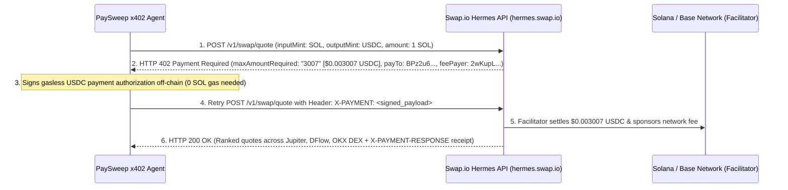

# ⚡ Swap.io x402 Hermes Autonomous Treasury Rebalancer (Solana)

🎥 **Watch Full 1m52s Pitch & Live Demo Video (1080p MP4):** [https://files.catbox.moe/em5ku9.mp4](https://files.catbox.moe/em5ku9.mp4)


---

# PaySweep x402: Autonomous Multi-Token Invoice Sweeper Agent for Solana (`Swap.io` × `x402`)

**Built for the `@swapdotio` × `@Superteam` x402 Use Case Pitch Bounty**  
**Author:** Kabeer Ahmed (`@kabeerahmed0120` · GitHub: `@Kabeer099`)  
**Live API Targeted:** `https://hermes.swap.io` (`Swap.io` Hermes Agent API over the `routhex` routing engine)  

---

## 1. The Concrete Scenario: Why Autonomous Invoice Sweeping Needs `x402`

Freelancers, indie SaaS tools, DAO treasuries, and autonomous AI worker agents on Solana frequently receive client or bounty payments in volatile SPL tokens (`SOL`, `JUP`, `PYTH`, `BONK`, `RAY`). To protect working capital without manual intervention, an autonomous background agent (**`PaySweep x402`**) watches the recipient wallet and immediately sweeps incoming non-stablecoin tokens into **`USDC`**.

### Why Legacy Swap APIs Break This Use Case
1. **Static API Keys & Human KYC:** Autonomous agents spun up in serverless containers or local CLI runtimes cannot complete human OAuth sign-ups, attach corporate credit cards, or manage rate-limit dashboards.
2. **Idle Subscription Burn (`$49–$199/mo`):** A freelancer or boutique AI agent might receive 10 to 50 payments per month. Paying `$49–$199/month` for a commercial DEX aggregator API subscription wastes **99%+** of capital during idle hours.
3. **The Gas Token Trap (`0 SOL` Failure):** When a new agent wallet receives an SPL token + USDC, standard flows fail if the wallet lacks native `SOL` for gas.

### Why `Swap.io` Hermes (`https://hermes.swap.io`) + `x402` Beats Every Alternative
- **Zero API Keys, Zero Subscriptions:** Every HTTP request pays for itself on-demand (`$0.003007 USDC` per quote). Sweeping **50 invoices/month costs just `$0.15 USDC` total** (`99.7%` cheaper than a `$49/mo` plan).
- **100% Gasless Payment Settlement:** On Solana, `Swap.io`'s facilitator (`feePayer: 2wKupLR9q6wXYppw8Gr2NvWxKBUqm4PPJKkQfoxHDBg4`) pays the network fee for the `x402` payment—your agent wallet only needs `USDC`, **zero `SOL` required**! (Also supports `base` via EIP-3009 gasless `USDC` authorization).
- **Zero Charge on Upstream Errors:** If an upstream DEX provider returns `4xx/5xx`, `Swap.io` passes the error through **without settling payment**.
- **Cryptographic Audit Trail (`X-PAYMENT-RESPONSE`):** Every paid `HTTP 200` response includes a verifiable on-chain settlement receipt header.

---

## 2. Step-by-Step `x402` Protocol Flow with `Swap.io`



---

## 3. Live Working Demo Output (`node agent.mjs`)

Running `node agent.mjs` against `https://hermes.swap.io` performs live endpoint discovery (`GET /v1/info`) across all 12 `routhex` endpoints and captures the real `HTTP 402` payment challenge from `POST /v1/swap/quote`:

```json
{
  "status": 402,
  "body": {
    "x402Version": 1,
    "accepts": [
      {
        "scheme": "exact",
        "network": "solana",
        "maxAmountRequired": "3007",
        "resource": "https://hermes.swap.io/v1/swap/quote",
        "description": "Paid swap API (routhex): quote and build unsigned transactions; caller signs and broadcasts",
        "mimeType": "application/json",
        "payTo": "BPz2u6eoWLervxEqfpsMCVmKk7h6fEVsd7L5rvEibMfD",
        "maxTimeoutSeconds": 60,
        "asset": "EPjFWdd5AufqSSqeM2qN1xzybapC8G4wEGGkZwyTDt1v",
        "extra": {
          "feePayer": "2wKupLR9q6wXYppw8Gr2NvWxKBUqm4PPJKkQfoxHDBg4"
        }
      },
      {
        "scheme": "exact",
        "network": "base",
        "maxAmountRequired": "3007",
        "resource": "https://hermes.swap.io/v1/swap/quote",
        "description": "Paid swap API (routhex): quote and build unsigned transactions; caller signs and broadcasts",
        "mimeType": "application/json",
        "payTo": "0xC22f661733B85C1349F7C83EE0B2BCF3234603dE",
        "maxTimeoutSeconds": 60,
        "asset": "0x833589fCD6eDb6E08f4c7C32D4f71b54bdA02913",
        "extra": {
          "name": "USD Coin",
          "version": "2"
        }
      }
    ]
  }
}
```

### Quickstart
```bash
node agent.mjs
```

### Included Files
- `agent.mjs` — Zero-dependency Node.js 22+ CLI agent for `hermes.swap.io` discovery & `x402` quote negotiation
- `hermes_v1_info.json` — Full live capture of `GET https://hermes.swap.io/v1/info` (all 12 endpoints)
- `hermes_402_challenge.json` — Full live capture of `POST https://hermes.swap.io/v1/swap/quote` (`HTTP 402` challenge)
- `slides/` — High-resolution `1920x1080` presentation deck slides

